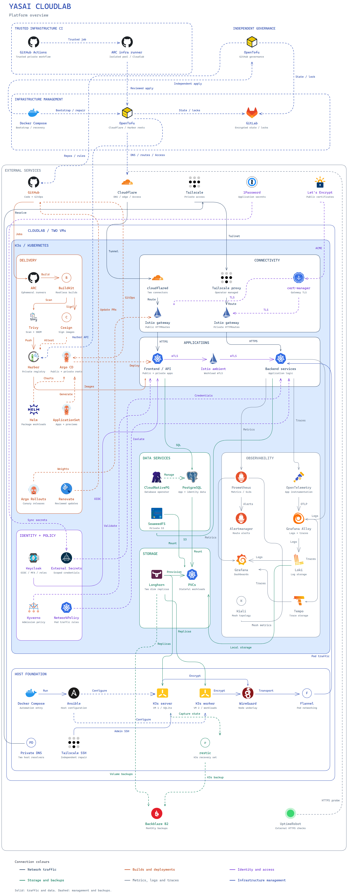
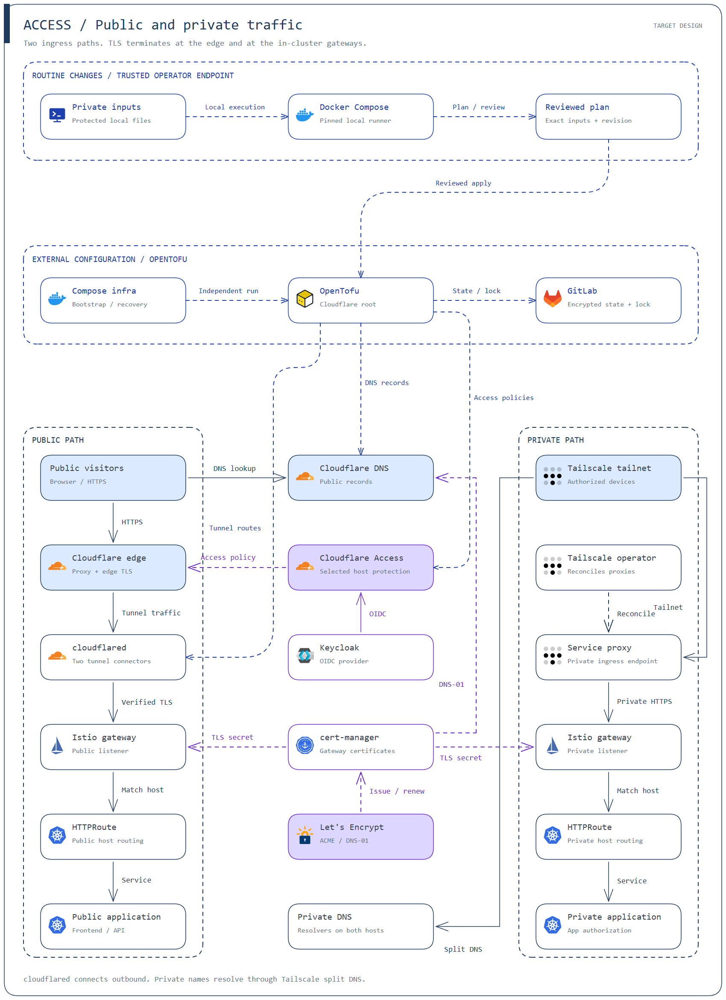
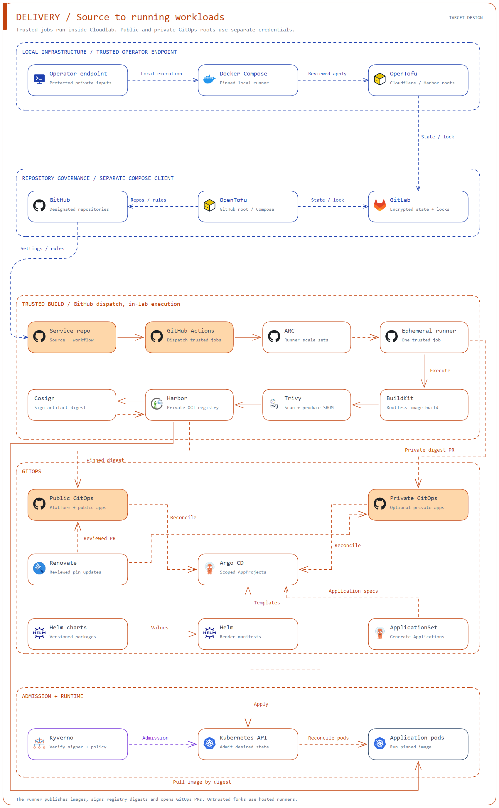
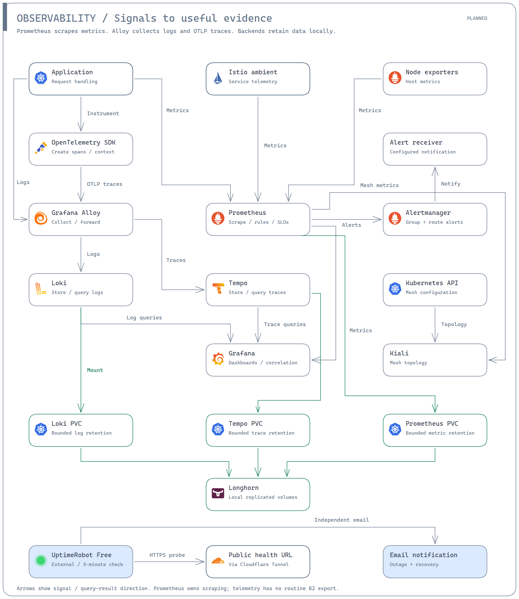
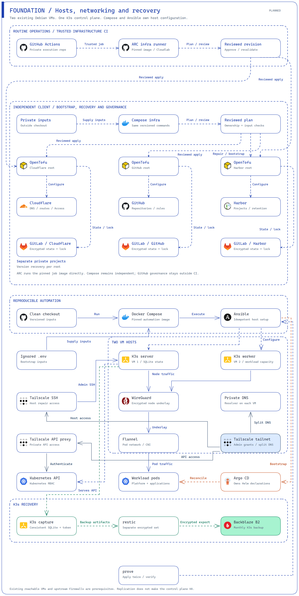

# yasai-cloudlab

A K3s cluster on two cloud VMs, managed with Ansible and Docker Compose.

[Architecture](#architecture) | [The lab](#the-lab) | [Setup](#setup) | [The stack](#the-stack) | [Detailed flows](#detailed-flows)

## Architecture

Ansible manages hosts, Argo CD manages Kubernetes, and local Compose runs OpenTofu
for external resources. GitLab stores encrypted infrastructure state.



## The lab

Both VMs run **Debian 13 (Trixie), x86_64**.

| VM | Role | CPU | Memory | Disk |
| --- | --- | --- | --- | --- |
| Main | Control plane + workloads | 16 vCPUs | 32 GB | 640 GiB |
| Worker | Workloads | 16 vCPUs | 32 GB | 640 GiB |

These are the current resources, not minimum requirements. The control plane
uses SQLite and depends on the main VM.

Automation installs missing host packages from the configured Debian repositories.
Distribution upgrades are managed separately.

## Setup

1. Clone this repo and install Docker with Compose on your local machine.
2. Prepare two reachable Debian 13 VMs with SSH access and automatic time
   synchronisation. VM creation and upstream firewall rules are managed outside
   this repo. Allow the required outbound traffic, including NTP.
3. Copy [`.env.example`](.env.example) to `.env`. Fill in both VM credential sets,
   the CloudLab read-only 1Password token and the inputs for enabled services.
4. Prepare the external services: a CloudLab vault, scoped Tailscale credentials,
   a B2 bucket and key, a restic password and credentials for Cloudflare DNS, Tunnel and Access.
   Keep application secrets in 1Password. Access and application credential fields
   are defined in the [access](platform/connectivity/access/contract.json),
   [data](platform/data/contract.json) and [identity](platform/identity/keycloak/contract.json)
   contracts. Inputs for host access are listed in `.env.example`. Backup inputs
   are defined by the [recovery module](ansible/playbooks/backup/files/runner.py).

From the repo directory, apply twice and verify:

```sh
docker compose run --build --rm lab prove
```

Use `lab setup` for convergence and verification. Run credential-free checks with
`lab validate` and `lab test`; see the [Ansible index](ansible/README.md).
`prove` applies the configuration twice and requires no changes on the second
apply on either VM. It then checks behaviour. GitOps bootstrap needs verified
Tailscale host access and a fresh recovery point for the control plane.
The [prerequisite checks](ansible/playbooks/argocd/tasks/prerequisites.yml) run first.
Running the configuration again preserves existing secrets and data.
If the accepted Argo application controller cannot start after an OOM kill, run
`docker compose run --rm lab gitops-controller-recover`. This uses published memory
settings, preserves StatefulSet and credential identities, and verifies handoff to
Argo without vault access. It can replace only an OOM-failed pod stuck on old
settings, with UID and version preconditions. Healthy controllers and unrelated
failures cannot receive memory changes.

External infrastructure runs separately through Compose: use `infra check cloudflare`,
`infra-github check github` and `infra-harbor check` before their named operations.
Each [native root](infra/) retains its own credentials, encrypted state, locks,
reviewed-plan gates and interrupted-operation recovery. Existing resources must
not repeat bootstrap. [Required inputs](ansible/playbooks/infrastructure/files/command.py)
remain outside deployment jobs; `infra-github verify github` checks governance
alongside `prove`.

Application onboarding uses the [service contract](charts/service/README.md),
administrator-controlled ApplicationSets and scoped data/OIDC references. The
[notes example](apps/notes/README.md) contains the web/API demonstration. Enable
services only with a reviewed catalog in the designated private configuration repo.
Argo reads approved service changes directly from Git; external provisioning and
retirement retain their explicit owner operations.

Monitoring uses the [monitoring contract](platform/observability/contract.json).
Keep `CloudLab/uptimerobot-management/API_KEY` in 1Password. Run `lab observe
external-check` before `external-apply`; verify outage and recovery email delivery
with its disposable notification fixture. Private Grafana and Kiali require
Keycloak. Run `lab observe credentials` with the local vault writer, then pipe
`gh auth token` to `docker compose run -T --rm lab observe identity-prepare`.
Merge its private client PR, add `grafana` and `kiali` to `PRIVATE_ACCESS_HOSTS`,
review `observability.enabled` in the public root, then run `prove`.
Git owns [dashboards](platform/observability/prometheus/dashboards) and
[Grafana settings](ansible/playbooks/observability/files/configuration.py).
Telemetry PVCs have local retention and no off-site backup. Identity enrollment
and [lifecycle operations](ansible/playbooks/keycloak/) remain explicit.

Harbor prerequisites use the [registry contract](ansible/playbooks/harbor/files/contract.json).
Inspect inputs with `docker compose run --rm --entrypoint python service -m playbooks.harbor.files.preflight`.
Keep ARC and public/private release Apps separate. Public runners use the reusable
`CloudLab/github-arc-public` App, with `APP_ID`, `INSTALLATION_ID` and `PRIVATE_KEY`,
installed only on approved public repositories, with repository Administration
write and Metadata read permissions and no organization grants. Private runners use `github-arc`.
All Actions jobs run locally; untrusted fork jobs are ineligible. Repository pools
share the [CI registration module](ansible/playbooks/ci/files/configuration.py).
Generate controller inputs with `--application-file` (JSON fields `name`,
`repository`, `visibility`) and an explicit `--output` directory. Review inputs in
the private GitOps catalog at `platform/ci/pools/<name>/controller.json`; add
`runner.json` only after workflow eligibility is approved. For routine app revisions,
use `--approve-repository-workflow --workflow-revision <reviewed-app-sha>` for
public repository-owned `test`/`publish` jobs. Their exact workflow bytes, assigned
runner names, protected main and current internal PR author permissions are checked
before any step. Scripts and build/test/publication logic stay in the application
repository. Changed workflow bytes require renewed approval.
For the retained shared-workflow interface,
add `--approve-workflow-template` with the reviewed `--workflow-revision` (and
`--pull-request` for initial internal PR setup). This pins caller bytes and each
single-job shared workflow to reviewed platform history;
the runner uses the job token's Contents and Pull requests read permissions to check
current protected main or an internal PR merge with GitHub before
running steps. Forks, stale commits and changed workflows fail closed. Argo continuously
repairs each pool's namespace and security profile. Qualify the published tools on
both nodes with `docker compose --profile ci run --rm ci-qualify` before enabling a pool.
Run the same Compose client with
`-m playbooks.harbor.files.control credentials` to create missing installation secrets locally.
Run `gh auth token | docker compose run -T --rm --entrypoint python service -m playbooks.harbor.files.control identity-prepare`
and merge its private client PR. Add `harbor` to `PRIVATE_ACCESS_HOSTS`, review
`harbor.enabled` in the public root, then run `prove`. Argo owns installation;
PostgreSQL, Valkey and blobs have separate retained Longhorn claims. Browser access
uses Keycloak; registry clients use scoped robots. Local restore checks use no B2;
coordinated off-site export and restore run on day 1 UTC only.
Daily freshness checks read local receipts; they report the initial off-site gap.
Manage registry projects through `docker compose run --build --rm infra-harbor`.
Its [API contract](infra/harbor/contract.json) defines vault fields, ownership,
native import formats and reviewed-plan requirements. Preserve existing robot
credentials. Retention keeps artifacts; automatic garbage collection stays off.
The [registry contract](ansible/playbooks/harbor/files/contract.json) owns separate
recovery signing inputs and coordinated restore requirements.

Argo reconciles [admission controllers](platform/delivery/admission/values.json)
and [workload rules](platform/delivery/admission/policies/values.yaml) from the public root.
Workload digest, resource and token rules are enforced; application namespaces retain restricted Pod Security.
Shared CI rules select platform-owned namespaces automatically. Runner rules use each
pool's generated role profile to constrain images, permissions, credentials and budgets;
only the assigned controller creates runner pods. CI namespace labels cannot bypass
policy selection. Rootless BuildKit retains only its qualified exceptions.
`prove` checks real admission responses without creating workloads.

Ansible installs [builder host profiles](ansible/playbooks/buildkit/010-host-profile.yml).
The [native runner values](platform/delivery/ci/runner.values.yaml) require Pod user
namespaces and explicit builder-only AppArmor, seccomp and SETUID/GID exceptions.
Builder verification runs sequential credential-free jobs on both nodes with a
process sandbox, CPU/memory/storage quotas and no host mounts or Docker socket.
`keyctl` returns ENOSYS; runc retains the Pod session keyring and process sandbox.

Build application controller, runner and builder images locally with
`docker compose --profile ci build ci-controller-image ci-runner-image ci-builder-image`.
[Sources and dependencies](platform/delivery/ci/tools/source.lock.json) are locked.
Publishing requires a server-enforced GitOps merge gate: only repository admins
may merge through PRs; release Apps cannot merge. Existing PR/check rules remain
independent. Private publishing stays blocked when the repository plan cannot
enforce this boundary. The local [workflow policy owner](infra/github-workflows)
keeps workflow tokens read-only and owns the public merge gate.

The [runner gate](platform/delivery/ci/runner/TrustedWorkflow.cs) checks original
job metadata against a read-only policy before action setup. PR jobs require current
repository write permission for the author; private membership labels do not grant access.
The runner uses UID
1001 and writable disposable storage for native JIT configuration and logs;
the builder uses UID 1000, a read-only filesystem and a pod-loopback API.
Each [controller](platform/delivery/ci/controller/values.json) watches only its assigned
repository namespace. The [runner pool](platform/delivery/ci/pool/values.json) requires
published image digests and approved workflow revisions before registration. It
permits one build per repository, ends the builder with its runner, and stops jobs when API or node
health fails. Its health role grants node listing and API readiness reads.
Shared [network policies](platform/delivery/ci/controller/templates/network-policy.yaml)
deny inbound traffic and private egress, except discovered API and Harbor hosts.
DNS uses CoreDNS; public HTTPS supports CI dependencies. Public HTTPS remains
an exfiltration path, so only trusted code may use lab runners.
Application Dockerfiles expose `test` and `runtime` targets. Registration supports
separate test and publisher pools within that one build budget. Public callers use
approved workflow bytes and protected main; private repositories can use explicit
main-commit approval when branch protection is unavailable. Each private source
change requires renewed approval; private PRs receive no runner access in that mode.

The [publisher](ansible/playbooks/ci/files/publisher.py) scans before pushing, signs
exact digests and proposes one application release file in its owning GitOps repo.
Public signing requires the exact shared workflow, GitHub issuer and source repository.
Signatures retain Cosign's supported compatibility format because the pinned Kyverno
bundle verifier omits certificate extension checks. The signed image identity uses
the public source repository; private registry addresses never enter transparency logs.
Private signing uses CloudLab items `ci-private-signer` (`private_key`, concealed)
and `ci-private-verifier` (`public_key`, string). Run `docker compose run --build --rm
ci-signing` locally to create missing items through the [custody owner](ansible/playbooks/ci/files/signing.py).
Existing keys survive repeats and interruptions. Only the private publisher receives
that private key; the Harbor recovery signer stays local and separate.
Export these images with `docker image save --output .infra-private/ci/<kind>.tar
yasai-cloudlab-ci-<kind>:local`, using `controller`, `runner` and `builder` for
`<kind>`. Create the ignored archive directory first. Then run
`docker compose --profile ci run --build --rm ci-bootstrap`. The local publisher
scans each archive against the [pinned database](platform/delivery/ci/scan.lock.json),
requires an unchanged accepted Harbor plan, and preserves immutable publications.
It uses retained vault robots and needs no ARC runner or Docker socket mount.
Add `--scan-only` to check archives without loading service credentials.

## The stack

**Available:** implemented here. **In progress:** open PR. **Planned:** not implemented.
Deployment still depends on inputs and verification.

### Cluster components

| Category | Component | Purpose | Status |
| --- | --- | --- | --- |
| Platform | K3s | Kubernetes with DNS, metrics and local storage | Available |
| Deployment | Argo CD | Private API, public platform root and optional scoped private sources | Available |
| Connectivity | WireGuard | Encrypted traffic between the VMs | Available |
| Host access | Tailscale | Independent SSH access with scoped enrolment credentials | Available |
| Private access | Tailscale operator + CoreDNS | L3 gateway ingress, independent private DNS and an authenticated Kubernetes API proxy | Available |
| HTTPS and mesh | cert-manager + Istio | Automatic certificates, separate public/private gateways and workload identity | Available |
| Security | Host firewalls | Restrict public access and keep cluster and ingress ports private | Available |
| Secrets | External Secrets Operator | Synchronise 1Password values into Kubernetes Secrets | Available |
| Storage | [Longhorn](https://github.com/longhorn/longhorn) | Persistent volumes with one replica on each VM | Available |
| Application data | CloudNativePG + SeaweedFS | Private SQL over TLS and authenticated S3, subject to restore checks | Available |
| Identity | Keycloak | Realm configuration, passkeys and application OIDC | Available |
| Recovery | SQLite + restic | Monthly control plane export with separate credentials and recovery checks | Available |
| Packaging | Helm | Versioned workload charts | Available |
| Runners | ARC | Ephemeral runners for trusted application builds | Planned |
| Registry | Harbor | Private OCI registry, separate Longhorn data and bounded OIDC sessions | In progress |
| Builds | BuildKit | Rootless image builds | Planned |
| Supply chain | Trivy + Cosign | Scan, sign and verify images | Planned |
| Policy | Kyverno + Pod Security | Enforce workload digest, resource and token rules; restricted application pods | Enforced |
| GitOps | ApplicationSet | Admin-approved app deployments and scoped data requests | Available |
| Releases | Argo Rollouts | Canary releases and previews | Planned |
| Metrics | Prometheus + Alertmanager | Metrics, SLOs and alerts | Available |
| Logs | Grafana Alloy + Loki | Collect and store redacted logs | Available |
| Traces | OpenTelemetry + Tempo | Collect and store traces | Available |
| Dashboards | Grafana + Kiali | Private service health and mesh views | Available |

**Storage:** Applications opt in to Longhorn. `local-path` remains the default.
Longhorn schedules monthly B2 backups and keeps the latest scheduled backup per
volume.

### External services

| Category | Service | Purpose | Status |
| --- | --- | --- | --- |
| Storage | [Backblaze B2](https://www.backblaze.com/cloud-storage) | External storage for Longhorn backups | Available |
| Secrets | 1Password | CloudLab vault, accessed with a read-only service account | Available |
| Public access | Cloudflare Tunnel + Access | Outbound tunnel, verified origin HTTPS and explicit human/machine policies | Available |
| Source | GitHub | Code and GitOps repositories | Available |
| Certificates | Let's Encrypt | Public TLS certificates | Available |
| Infrastructure state | GitLab | Encrypted state with a separate lock for each root | Available |
| Monitoring | UptimeRobot | Independent HTTPS checks and email alerts | Available |

### Automation

| Tool | Purpose | Status |
| --- | --- | --- |
| Ansible | Configure and verify hosts and the cluster | Available |
| Docker Compose | Run the pinned automation environment | Available |
| OpenTofu | Manage external resources locally through Compose | Available |
| GitHub Actions | Trusted application builds through ARC | Planned |
| Renovate | Reviewed dependency updates | Planned |

## Detailed flows

Diagrams show the target design, including planned components. The stack tables
show implementation status.

### Access

Cloudflare Tunnel carries public requests to the public Istio gateway.
Tailscale carries private requests to a separate gateway. Both route to apps over
HTTPS. cert-manager manages certificates and Cloudflare Access protects selected public hosts.
Local Compose runs apply reviewed OpenTofu changes to Cloudflare DNS, tunnel routes
and Access policies. Certificate DNS-01 records remain with cert-manager.



### Identity

Users sign in through Keycloak. The platform realm serves operator tools; the
applications realm serves apps. Serialized config-cli jobs reconcile managed
identity settings. Apps validate OIDC access tokens and roles to control access.
External Secrets copies scoped credentials from 1Password into Kubernetes.
Background refreshes run once a day to bound vault requests. Explicit
credential rotations request immediate refresh; failed synchronization retains
existing Secrets and reports degraded health. Other vault edits can take up to
24 hours to reach applications.
Apply retries an exhausted root or identity sync only when its failures were
ExternalSecrets that became Ready after the failed operation. Other failures
remain visible; retries preserve the source, credentials and data.
Istio encrypts traffic between workloads and checks which services may communicate.


### Delivery

The planned build path uses GitHub Actions and ARC workers in Cloudlab. Images
are built, scanned, signed and stored in Harbor. Argo CD reads public or private
GitOps repos and deploys the selected images. OpenTofu runs locally through Compose on a trusted
operator endpoint. GitHub governance uses a separate Compose client.



### Releases

The planned release path uses Argo Rollouts and a Gateway API plugin to adjust
HTTPRoute weights. Per-revision Prometheus metrics and bounded k6 tests guide
promotion or abort; missing metrics or insufficient samples block promotion.
ApplicationSet creates private previews for exact approved revisions. Dedicated
cleanup removes previews when their PR closes or their lifetime expires.


### Data

Apps use PostgreSQL managed by CloudNativePG and private S3 storage from SeaweedFS.
The data module provisions application SQL grants and buckets.
Longhorn replicates their volumes across both VMs; the database and S3 services
remain single-instance. Coordinated monthly Longhorn backups go to B2.
Isolated restores check databases and objects together. Replication is not backup.


### Observability

Prometheus collects metrics. Alloy sends logs to Loki and traces to Tempo.
Git provisions dashboards, data sources and alert rules.
Grafana brings these signals together, Kiali shows mesh traffic and Alertmanager
routes alerts. Grafana and Kiali require Keycloak. Kiali reads mesh configuration
and inspects the control plane through pod port-forwarding restricted to
`istio-system`. UptimeRobot checks public health independently every five minutes
and sends outage and recovery emails. Telemetry stays on local Longhorn storage
with bounded retention and no routine B2 backup.



### Foundation

Compose runs Ansible to configure both VMs and K3s. A trusted operator endpoint
runs Compose to apply reviewed OpenTofu changes to Cloudflare and Harbor, with
encrypted state and separate locks per root in GitLab. Compose also handles
bootstrap, recovery and separate GitHub governance.
K3s recovery uses a separate monthly restic backup to B2.


