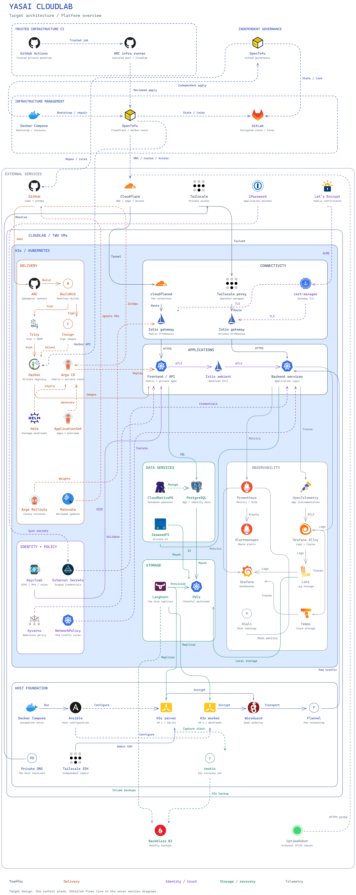
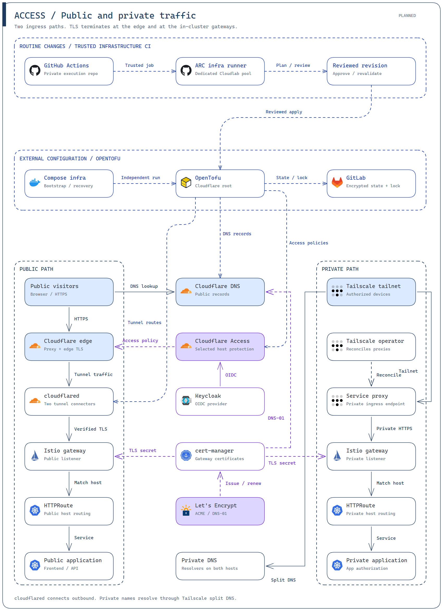
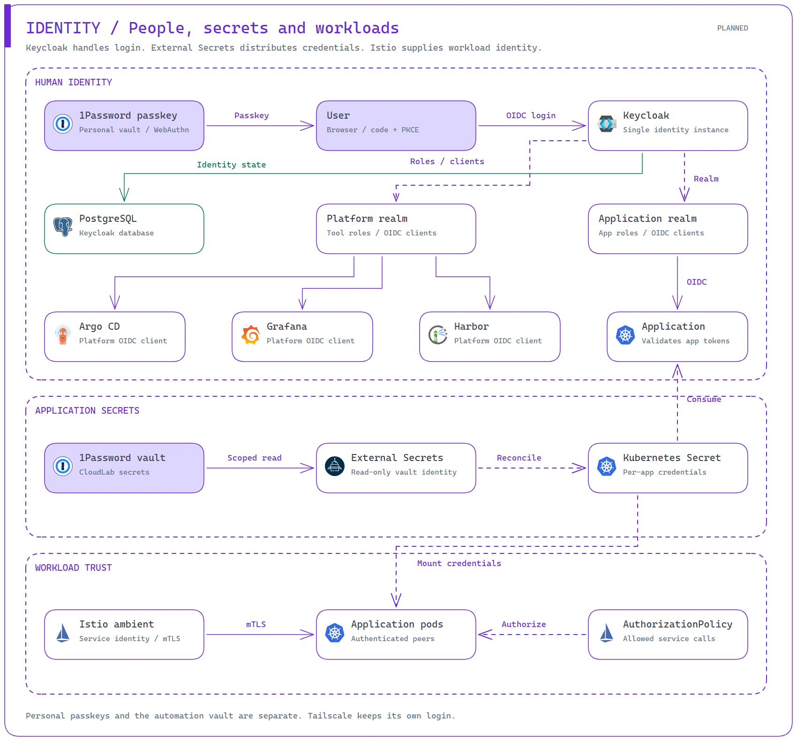
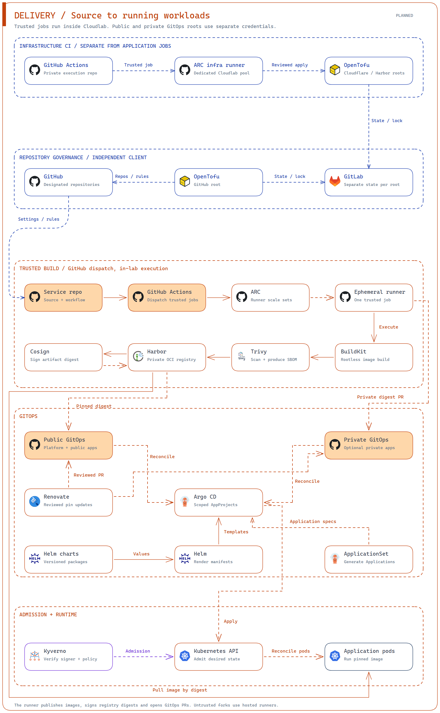
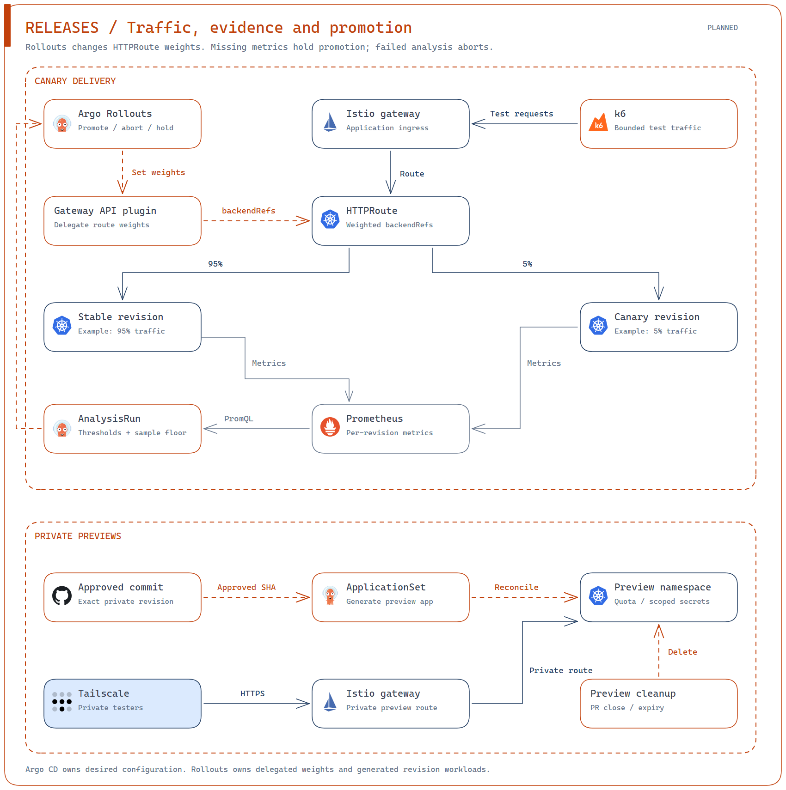
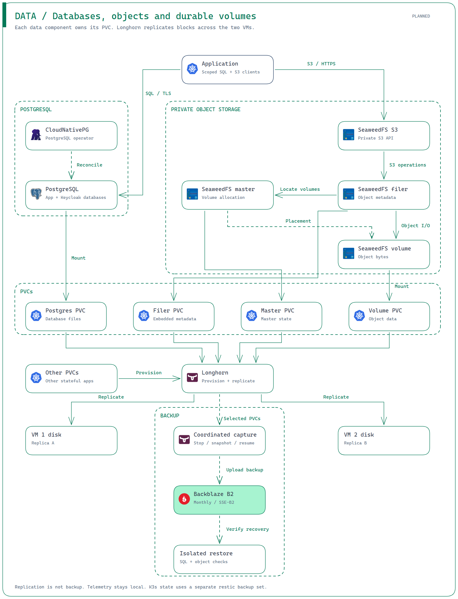

# yasai-cloudlab

Two cloud VMs, one K3s cluster. Managed as code with Ansible and Docker Compose.

## The lab

Both VMs run **Debian 13 (Trixie), x86_64**.

| VM | Role | CPU | Memory | Disk |
| --- | --- | --- | --- | --- |
| Main | Control plane + workloads | 16 vCPUs | 32 GB | 640 GiB |
| Worker | Workloads | 16 vCPUs | 32 GB | 640 GiB |

These are the current resources, not minimum requirements. The control plane
uses SQLite and depends on the main VM.

## Cluster components

**Available:** implemented here. **In progress:** open PR. **Planned:** not implemented.
Deployment still depends on inputs and verification.

| Category | Component | Purpose | Status |
| --- | --- | --- | --- |
| Platform | K3s | Kubernetes with bundled DNS, metrics, and local storage | Available |
| Deployment | Argo CD | Private API, public platform root and optional scoped private sources | Available |
| Connectivity | WireGuard | Encrypted traffic between the VMs | Available |
| Host access | Tailscale | Independent SSH access; requires scoped enrollment credentials | Available |
| Private access | Tailscale operator + CoreDNS | L3 gateway ingress, independent private DNS and an authenticated Kubernetes API proxy | Available |
| HTTPS and mesh | cert-manager + Istio | Automatic certificates, separate public/private gateways and workload identity | Available |
| Security | Host firewalls | Restrict public access; keep cluster and ingress ports private | Available |
| Secrets | External Secrets Operator | Synchronize 1Password values into Kubernetes Secrets | Available |
| Storage | [Longhorn](https://github.com/longhorn/longhorn) | Persistent volumes with one replica on each VM | Available |
| Application data | CloudNativePG + SeaweedFS | Private SQL/TLS and authenticated S3; gated by restore acceptance | Available |
| Identity | Keycloak | Realm configuration, passkeys and application OIDC | Available |
| Recovery | SQLite + restic | Consistent monthly control-plane export; separate credentials and acceptance | Available |
| Packaging | Helm | Versioned workload charts | Available |
| Runners | ARC | Separate application and infrastructure runners | Planned |
| Registry | Harbor | Private images and OCI charts | Planned |
| Builds | BuildKit | Rootless image builds | Planned |
| Supply chain | Trivy + Cosign | Scan, sign and verify images | Planned |
| Policy | Kyverno | Admission and image policies | Planned |
| GitOps | ApplicationSet | Generate app deployments | Planned |
| Releases | Argo Rollouts | Canary releases and previews | Planned |
| Metrics | Prometheus + Alertmanager | Metrics, SLOs and alerts | Planned |
| Logs | Grafana Alloy + Loki | Collect and store logs | Planned |
| Traces | OpenTelemetry + Tempo | Collect and store traces | Planned |
| Dashboards | Grafana + Kiali | Service health and mesh views | Planned |

## External services

| Category | Service | Purpose | Status |
| --- | --- | --- | --- |
| Storage | [Backblaze B2](https://www.backblaze.com/cloud-storage) | External storage for Longhorn backups | Available |
| Secrets | 1Password | CloudLab vault, accessed with a read-only service account | Available |
| Public access | Cloudflare Tunnel + Access | Outbound tunnel, verified origin HTTPS and explicit human/machine policies | Available |
| Source | GitHub | Code and GitOps repositories | Available |
| Certificates | Let's Encrypt | Public TLS certificates | Available |
| Infrastructure state | GitLab | Encrypted state and per-root locks | In progress ([#117](https://github.com/UncleThreeHomeLab/yasai-cloudlab/pull/117)) |
| Monitoring | UptimeRobot | External HTTPS checks | Planned |

**Storage:** Applications opt in to Longhorn; `local-path` remains the default.
Longhorn schedules monthly B2 backups and keeps the latest scheduled backup per
volume.

## Automation

| Tool | Purpose | Status |
| --- | --- | --- |
| Ansible | Configure hosts and cluster; verify the result | Available |
| Docker Compose | Run the pinned automation environment | Available |
| OpenTofu | External resources; Compose bootstrap and recovery | In progress ([#117](https://github.com/UncleThreeHomeLab/yasai-cloudlab/pull/117)) |
| GitHub Actions | Trusted builds and infrastructure jobs through ARC | Planned |
| Renovate | Reviewed dependency updates | Planned |

Automation installs missing host packages from configured Debian repositories;
distribution upgrades are managed separately. Bootstrap inputs are listed in
[`.env.example`](.env.example); private values stay in ignored `.env`.

## Setup

1. Clone this repo and install Docker with Compose on your local machine.
2. Prepare two reachable Debian 13 VMs with SSH access and automatic time
   synchronization. VM creation and upstream firewall rules are managed outside
   this repo; allow the required outbound traffic, including NTP.
3. Copy [`.env.example`](.env.example) to `.env`. Fill in both VM credential sets,
   the CloudLab read-only 1Password token, and the enabled service inputs.
4. Prepare the external services: a CloudLab vault, scoped Tailscale credentials,
   a B2 bucket/key and restic password, and Cloudflare DNS/tunnel/Access credentials.
   Keep application secrets in 1Password. Access and application credential fields
   are defined in the [access](platform/connectivity/access/contract.json),
   [data](platform/data/contract.json) and [identity](platform/identity/keycloak/contract.json)
   contracts. Host-access inputs are listed in `.env.example`; backup inputs are
   defined by the [recovery module](automation/recovery/runner.py).

From the repo directory, apply and verify:

```sh
docker compose run --build --rm lab prove
```

`prove` applies twice, requires zero changes on the second apply on both VMs,
then verifies behavior. GitOps bootstrap requires verified Tailscale host access
and a fresh control-plane recovery point; its [prerequisite checks](ansible/roles/gitops/tasks/prerequisites.yml)
run before bootstrap. Repeat application preserves existing secrets and data.

## Architecture

Public traffic enters through Cloudflare; private traffic uses Tailscale.
Istio routes requests to apps, Argo CD deploys them, and Longhorn stores their data.
These diagrams include planned components; the tables above show implementation status.



### Access

Cloudflare Tunnel carries public requests to the public Istio gateway.
Tailscale carries private requests to a separate gateway. Both route to apps over
HTTPS; cert-manager manages certificates, and Cloudflare Access protects selected public hosts.



### Identity

Users sign in through Keycloak; apps use OIDC tokens and roles to control access.
External Secrets copies scoped credentials from 1Password into Kubernetes.
Istio encrypts traffic between workloads and checks which services may communicate.



### Delivery

GitHub Actions runs trusted builds on ARC workers in Cloudlab. Images are built,
scanned, signed and stored in Harbor. Argo CD reads public or private GitOps repos
and deploys the selected images. Dedicated infrastructure runners execute OpenTofu;
GitHub governance stays on independent Compose.



### Releases

Argo Rollouts sends a small share of traffic to a new revision. Prometheus metrics
and k6 tests guide promotion or rollback. ApplicationSet creates private previews
for approved revisions; closing or expiring a preview removes its resources.



### Data

Apps use PostgreSQL managed by CloudNativePG and private S3 storage from SeaweedFS.
Their PVCs use Longhorn replicas across both VMs. Coordinated monthly backups go
to B2; isolated restores check that databases and objects can be recovered.



### Observability

Prometheus collects metrics; Alloy sends logs to Loki and traces to Tempo.
Grafana brings these signals together, Kiali shows mesh traffic, and Alertmanager
routes alerts. UptimeRobot checks public access independently. Telemetry stays on local storage.


### Foundation

Compose runs Ansible to configure both VMs and K3s. Dedicated ARC runners apply
reviewed OpenTofu changes to Cloudflare and Harbor, with encrypted state in GitLab.
Compose remains available for bootstrap, recovery and GitHub governance.
K3s recovery uses a separate monthly restic backup to B2.


Logos identify their projects. [Logo sources](docs/architecture/logo-sources.json).
