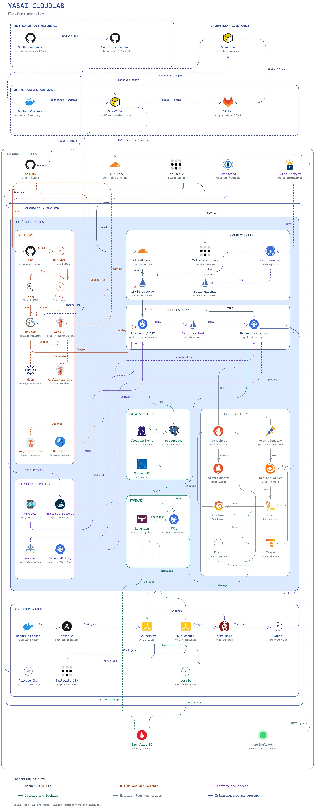
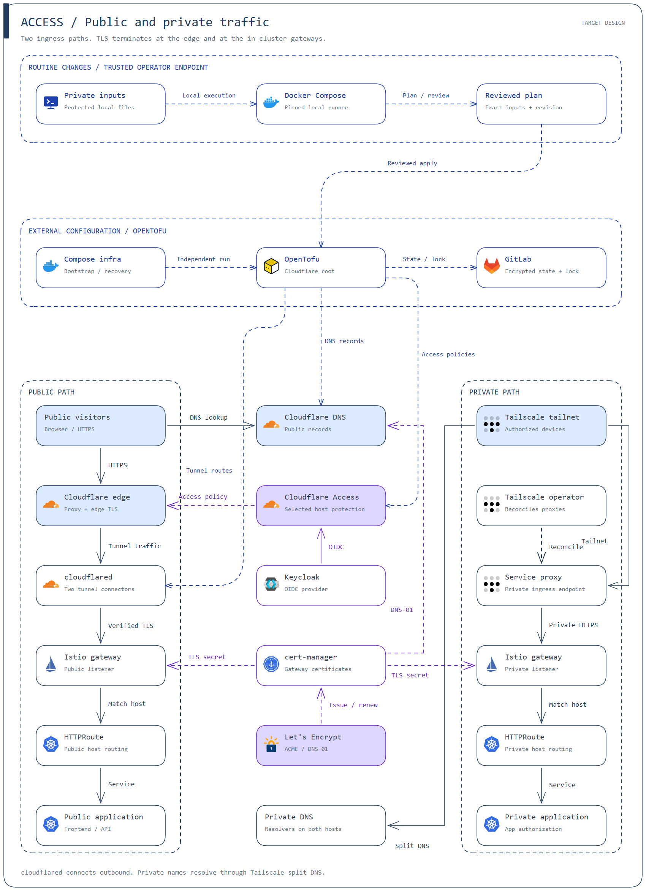
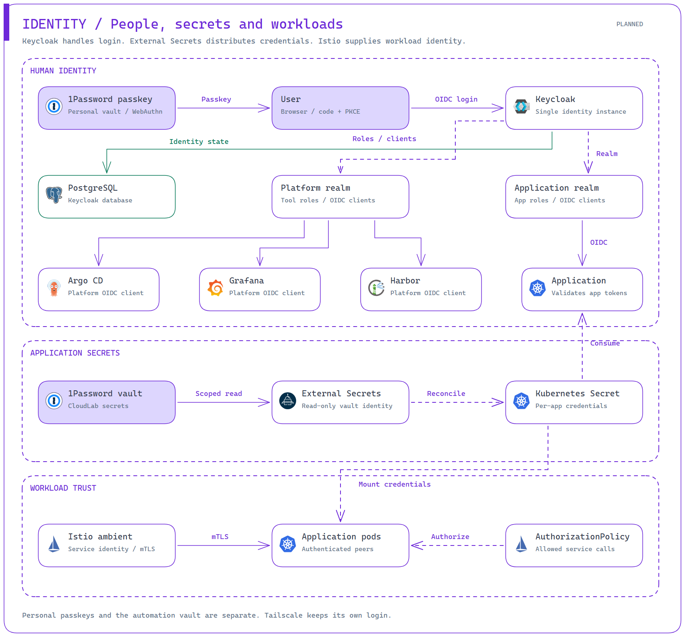
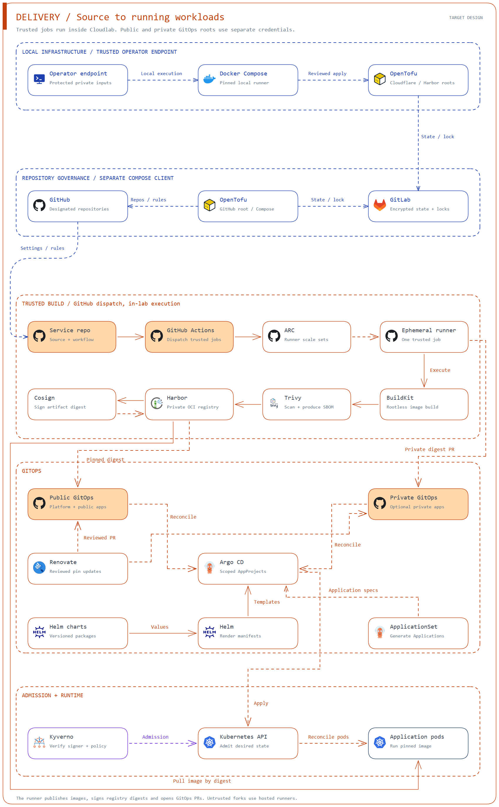
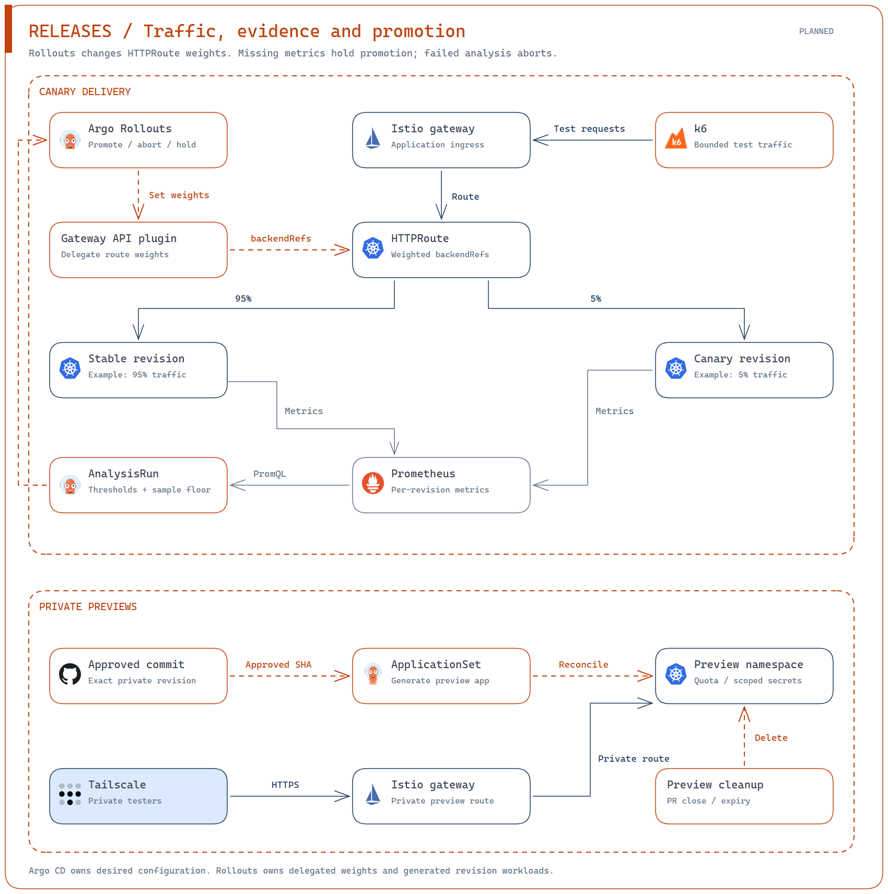
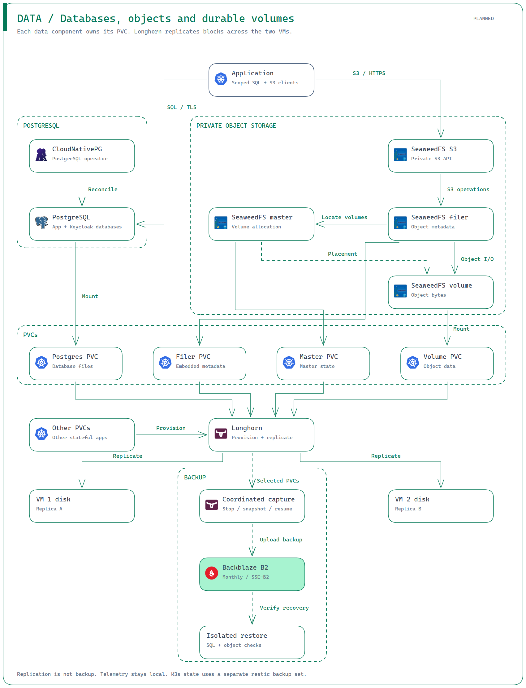
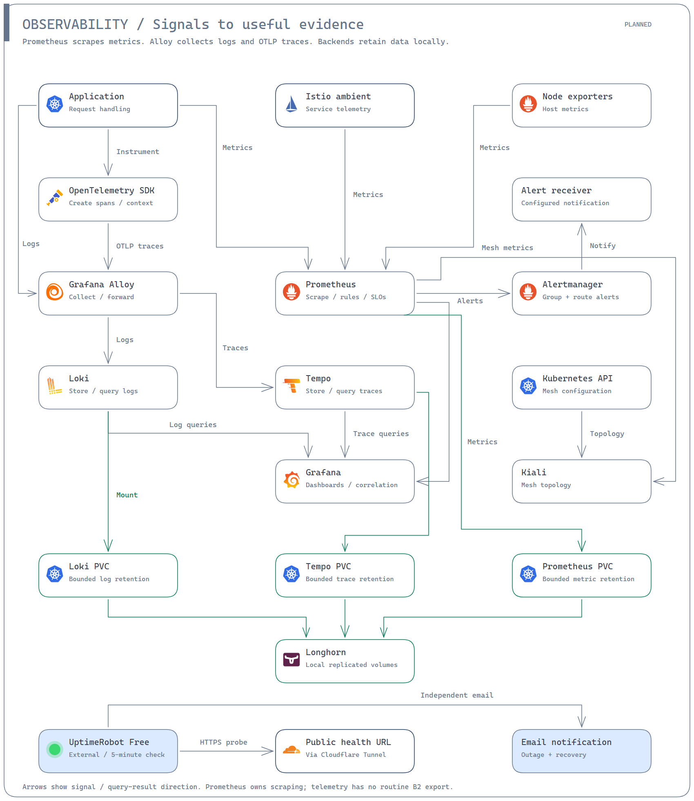
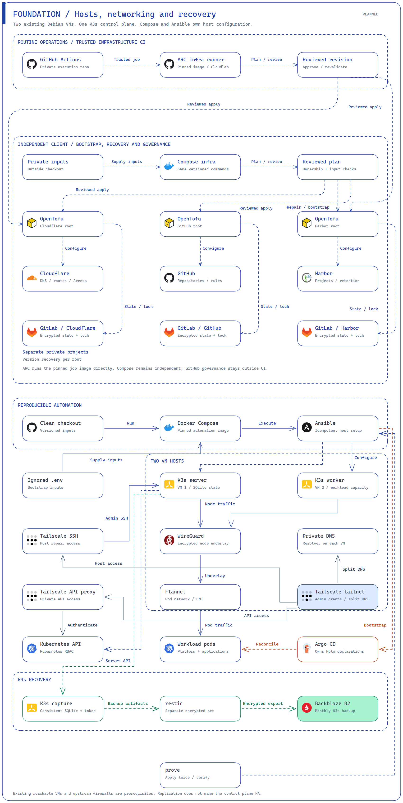

# yasai-cloudlab

A two-VM Kubernetes lab for hosting apps, with GitOps delivery, private access,
shared storage and monitoring. Docker Compose runs the automation locally.

[Architecture](#architecture) | [The lab](#the-lab) | [Setup](#setup) | [The stack](#the-stack) | [Detailed flows](#detailed-flows)

## Architecture

Ansible configures hosts, Argo CD deploys workloads, and OpenTofu manages external resources.



## The lab

Both VMs run **Debian 13 (Trixie), x86_64**.

| VM | Role | CPU | Memory | Disk |
| --- | --- | --- | --- | --- |
| Main | Control plane + workloads | 16 vCPUs | 32 GB | 640 GiB |
| Worker | Workloads | 16 vCPUs | 32 GB | 640 GiB |

Current resources, not minimum requirements. The SQLite control plane depends on
Main. Automation installs missing packages from Debian repositories; distribution
upgrades are managed separately.

## Setup

1. **Prepare your computer.** Install Git and Docker with Compose on Linux, macOS
   or Windows. Start Docker, clone this repository and open its directory.
2. **Prepare two VMs.** Use Debian 13 with SSH access, automatic time synchronisation
   and required outbound traffic, including NTP. Create the VMs and configure upstream
   firewalls outside this repository.
3. **Set local inputs.** Copy [`.env.example`](.env.example) to `.env`. Fill in both
   VM credential sets, `OP_SERVICE_ACCOUNT_TOKEN` and inputs for enabled services.
   Keep `.env` private.
4. **Prepare service credentials.** Use a CloudLab 1Password vault with a read-only
   service account. Prepare scoped Tailscale credentials, a B2 bucket/key, a restic
   password and Cloudflare DNS, Tunnel and Access credentials. Keep application
   secrets in 1Password. Required fields live with [host access](ansible/playbooks/tailscale/),
   [recovery](ansible/playbooks/backup/files/runner.py),
   [access](platform/connectivity/access/contract.json),
   [data](platform/data/contract.json) and [identity](platform/identity/keycloak/contract.json).
5. **Install and verify.** Run from the repository directory:

   ```sh
   docker compose run --build --rm lab prove
   ```

   This applies twice, requires zero changes on the second apply on both VMs,
   then verifies behaviour. Repeat runs preserve existing secrets and data.
   GitOps bootstrap requires verified Tailscale host access and a fresh recovery point.

External resources use separate reviewed OpenTofu operations through Compose;
see [infrastructure inputs and gates](ansible/playbooks/infrastructure/files/command.py).
For later use: [automation](ansible/README.md),
[app onboarding](docs/service-onboarding.md), [previews](platform/delivery/previews/contract.json)
and [dependency updates](platform/delivery/dependencies/maintenance.yaml).

## The stack

### Cluster components

| Category | Component | Purpose |
| --- | --- | --- |
| Platform | K3s | Kubernetes with DNS, metrics and local storage |
| Deployment | Argo CD | Private API, public platform root and optional scoped private sources |
| Connectivity | WireGuard | Encrypted traffic between the VMs |
| Host access | Tailscale | Independent SSH access with scoped enrolment credentials |
| Private access | Tailscale operator + CoreDNS | L3 gateway ingress, independent private DNS and an authenticated Kubernetes API proxy |
| HTTPS and mesh | cert-manager + Istio | Automatic certificates, separate public/private gateways and workload identity |
| Security | Host firewalls | Restrict public access and keep cluster and ingress ports private |
| Secrets | External Secrets Operator | Synchronise 1Password values into Kubernetes Secrets |
| Storage | [Longhorn](https://github.com/longhorn/longhorn) | Persistent volumes with one replica on each VM |
| Application data | CloudNativePG + SeaweedFS | Private SQL over TLS and authenticated S3, subject to restore checks |
| Identity | Keycloak | Realm configuration, passkeys and application OIDC |
| Recovery | SQLite + restic | Monthly control plane export with separate credentials and recovery checks |
| Packaging | Helm | Versioned workload charts |
| Runners | ARC | Ephemeral runners for trusted application builds |
| Registry | Harbor | Private OCI registry, separate Longhorn data and bounded OIDC sessions |
| Builds | BuildKit | Rootless image builds |
| Supply chain | Trivy + Cosign | Scan, sign and verify images |
| Policy | Kyverno + Pod Security | Enforce workload digest, resource and token rules; restricted application pods |
| GitOps | ApplicationSet | Admin-approved app deployments and scoped data requests |
| Releases | Argo Rollouts | HTTPRoute canaries with per-revision Prometheus analysis |
| Previews | ApplicationSet + Istio waypoint | Exact-revision private previews with close/expiry cleanup |
| Metrics | Prometheus + Alertmanager | Metrics, SLOs and alerts |
| Logs | Grafana Alloy + Loki | Collect and store redacted logs |
| Traces | OpenTelemetry + Tempo | Collect and store traces |
| Dashboards | Grafana + Kiali | Private service health and mesh views |

**Storage:** Applications opt in to Longhorn. `local-path` remains the default.
Longhorn schedules monthly B2 backups and keeps the latest scheduled backup per
volume.

### External services

| Category | Service | Purpose |
| --- | --- | --- |
| Storage | [Backblaze B2](https://www.backblaze.com/cloud-storage) | External storage for Longhorn backups |
| Secrets | 1Password | CloudLab vault, accessed with a read-only service account |
| Public access | Cloudflare Tunnel + Access | Outbound tunnel, verified origin HTTPS and explicit human/machine policies |
| Source | GitHub | Code and GitOps repositories |
| Certificates | Let's Encrypt | Public TLS certificates |
| Infrastructure state | GitLab | Encrypted state with a separate lock for each root |
| Monitoring | UptimeRobot | Independent HTTPS checks and email alerts |

### Automation

| Tool | Purpose |
| --- | --- |
| Ansible | Configure and verify hosts and the cluster |
| Docker Compose | Run the pinned automation environment |
| OpenTofu | Manage external resources locally through Compose |
| GitHub Actions | Trusted application builds through ARC |
| [Renovate](platform/delivery/dependencies/maintenance.yaml) | Draft proposals and verified dependency updates |

## Detailed flows

Diagrams include planned components; inclusion in the stack does not imply deployment readiness.

### Access

Cloudflare handles public access; Tailscale handles private access through separate Istio gateways.



### Identity

Keycloak handles sign-in, External Secrets syncs 1Password credentials, and Istio secures workload traffic.



### Delivery

Planned: GitHub Actions builds, scans and signs images into Harbor; Argo CD deploys from GitOps.



### Releases

Canaries use traffic weights and metrics; private previews expire or close with their PR.



### Data

CloudNativePG provides PostgreSQL; SeaweedFS provides private S3 storage.
Longhorn replicates volumes across both VMs, with monthly B2 backups and isolated restore checks.
Database and S3 services remain single-instance; replication is not backup.



### Observability

Grafana and Kiali show metrics, logs, traces and mesh health; Alertmanager and UptimeRobot send alerts.



### Foundation

Compose runs Ansible and reviewed OpenTofu operations. GitLab stores encrypted infrastructure state;
separate monthly restic backups protect the K3s control plane.


